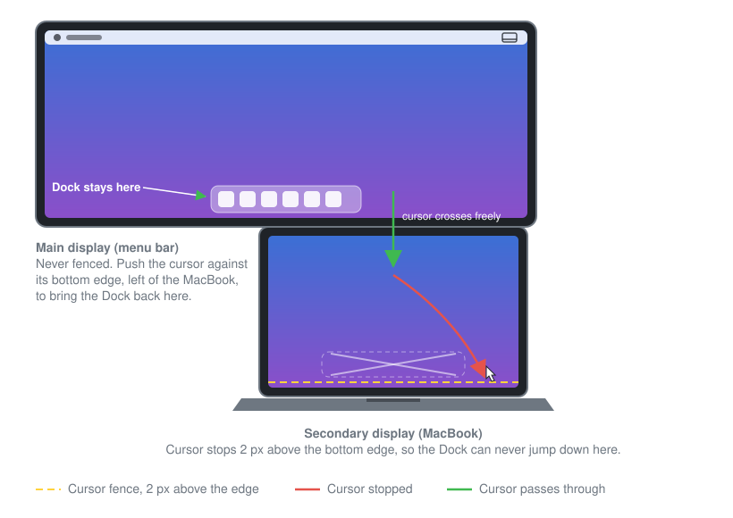

# Dock Stay Putter

Dock Stay Putter is a minimal macOS menu bar app that keeps the Dock from jumping to a secondary display.



## What it does

macOS moves the Dock to another display when you push the cursor against the bottom edge of that display. Dock Stay Putter stops the cursor from reaching that edge on every display except the main display, so the Dock stays where you put it.

## Example layout

The diagram shows a common setup: a wide external display on top, with the menu bar, and a MacBook display directly below it.

- The external display is the main display, so it's never fenced. The Dock lives on its bottom edge.
- The MacBook display is a secondary display with nothing below it, so the app fences its bottom edge. The cursor stops 2 px short, and the Dock can't jump down.
- The shared edge between the two displays stays open. The cursor crosses from the external display into the MacBook display as usual.

If the Dock has already moved to the MacBook display, push the cursor against the bottom edge of the external display in a region where the MacBook display isn't below it. macOS moves the Dock back, and the app keeps it there.

## How it works

- The app installs a `CGEventTap` on the session event stream. The tap watches mouse-move and mouse-drag events.
- When the cursor is within 2 px of the bottom edge of a secondary display, the app moves it back to 2 px above that edge.
- The main display is never fenced. It's the display that has the menu bar, as set in **System Settings > Displays**.
- If another display is stacked directly below a secondary display, the app lets the cursor cross, so you can still move between stacked displays.
- The app recomputes display geometry when it receives `NSApplication.didChangeScreenParametersNotification`, so plugging in, unplugging, or rearranging displays takes effect right away.

## Requirements

- macOS 13 or later.
- Xcode or the Command Line Tools with Swift 5.9 or later.

## Build

To build the app bundle, run:

```sh
./build.sh
```

The script writes the app to `build/DockStayPutter.app` and signs it ad hoc.

To build the app, copy it to `/Applications`, and launch it, run:

```sh
./build.sh --install
```

## Grant Accessibility access

An active event tap requires Accessibility access. The app shows the system prompt on first launch.

1. Launch the app. A menu bar icon appears, and it looks dimmed until access is granted.
2. Open **System Settings > Privacy & Security > Accessibility**. You can also choose **Open Accessibility Settings…** from the menu bar icon.
3. Turn on **Dock Stay Putter**. If it isn't in the list, click **+** and add it.

The app checks every 2 seconds and starts fencing the cursor as soon as you grant access.

## Menu bar controls

- **Enabled:** Turns the cursor fence on or off. The app remembers your choice.
- **Launch at Login:** Starts the app when you log in.
- **Open Accessibility Settings…:** Appears only when the app doesn't have access yet.
- **Quit Dock Stay Putter:** Quits the app. You can also press Command+Q while the menu is open.

## Launch at Login notes

The app uses `SMAppService.mainApp` to register as a login item. macOS might report "requires approval" until the app is in `/Applications` and you approve it in **System Settings > General > Login Items**. When that happens, the app opens the Login Items pane for you. Use `./build.sh --install` to put the app in the right place.

## Caveats

- Ad-hoc signing means each rebuild changes the code signature. macOS might ask for Accessibility access again. If the cursor isn't fenced after a rebuild, remove Dock Stay Putter from the Accessibility list and add it again.
- The app only affects the bottom edge. If your Dock is on the left or right edge, this app doesn't protect it.
- The main display is the one with the menu bar, as set in **System Settings > Displays**.

## Uninstall

1. Choose **Launch at Login** to turn it off, if it's on.
2. Choose **Quit Dock Stay Putter**.
3. Delete `/Applications/DockStayPutter.app`.
4. Optional: remove Dock Stay Putter from **System Settings > Privacy & Security > Accessibility**.
